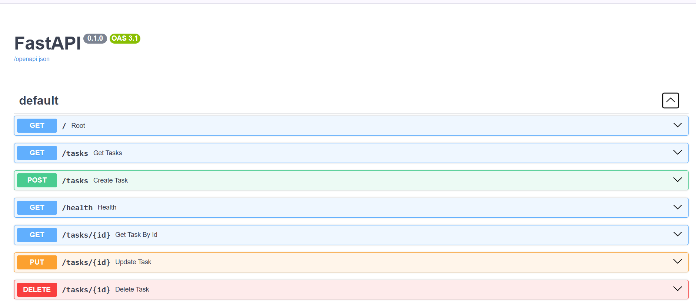

# Tasks CRUD API

A clean and fast RESTful CRUD API built with **Python** and **FastAPI** to manage everyday tasks.

## 🚀 How to Install & Run

You can get this API running locally in under 2 minutes:

```bash
# Install the required packages
pip install fastapi uvicorn

# Start the local development server
uvicorn main:app --reload
```

Once started, open your browser and go to:
* **Interactive Documentation:** [http://localhost:8000/docs](http://localhost:8000/docs)

---

## 📋 API Endpoints Table

| Method | Endpoint | Description | Status Code |
| :--- | :--- | :--- | :--- |
| **GET** | `/` | Returns a system welcome message Hello Server | `200 OK` |
| **GET** | `/health` | Returns the status of the server status:ok | `200 OK` |
| **GET** | `/tasks` | Retrieves the full list of all saved tasks | `200 OK` |
| **GET** | `/tasks/{id}` | Retrieves details of a single task using its unique ID | `200 OK` / `404 Not Found` |
| **POST** | `/tasks` | Creates a brand new task item | `201 Created` |
| **PUT** | `/tasks/{id}` | Replaces a task's title and/or status | `200 OK` / `400 Bad Request` / `404 Not Found` |
| **DELETE**| `/tasks/{id}` | Permanently removes a task (Empty body) | `204 No Content` / `404 Not Found` |
---

## 📸 Swagger UI Dashboard

FastAPI automatically generates this interactive dashboard from our codebase:



---

## 💻 Sample `curl -i` Response Example

Here is what our `DELETE` route looks like when tested via terminal tools (showing the empty body with a `204` header status):

```http
HTTP/1.1 204 No Content
date: Tue, 20 Oct 2026 06:02:54 GMT 
server: uvicorn 
```


## ⚠️ The Mortality Experiment

After restarting the server, newly created tasks disappeared, and the original tasks reappeared. This happened because tasks are stored in an in-memory Python list, which resets when the server restarts.